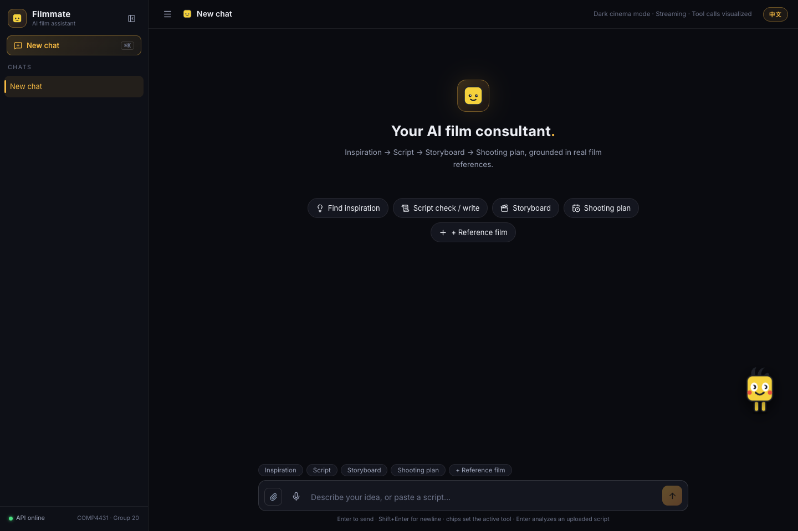
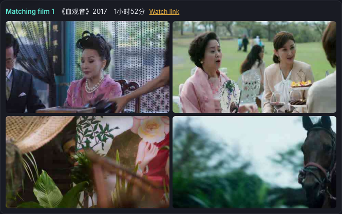
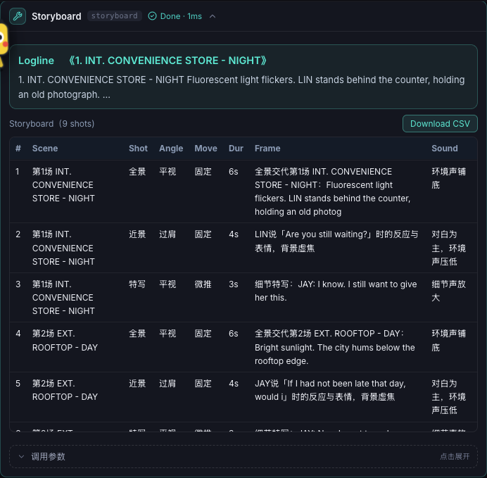
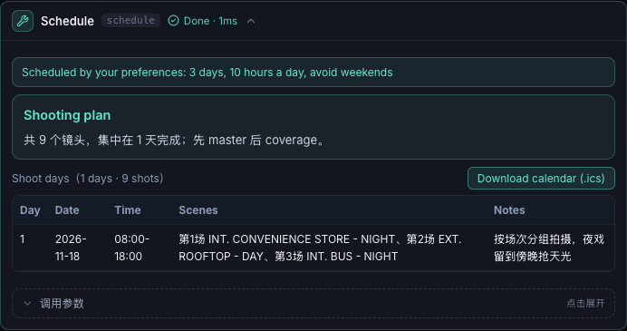
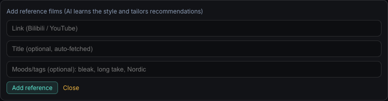

COMP4431 Artificial Intelligence Group 20
| Student name | Student ID |
|---|---|
| CHAN Chi Kit (Jacky) | 24029821D |
| LI Xiang (Oliver) | 23102587d |
| ZHAO Allen | 22108077d |

# Filmmate

**A domain-specific AI assistant for film and video creators.**
Inspiration → Script → Storyboard → Shooting plan → + Reference film.

[](https://www.python.org/)
[](https://fastapi.tiangolo.com/)
[](https://react.dev/)
[](https://www.typescriptlang.org/)
[](https://platform.deepseek.com/)

Filmmate is a course project for **COMP4431 Artificial Intelligence (2026/27), Group 20**. It is a chatbot for the pre-production workflow of a small film team: find a reference, check or write a script, turn the script into a shot list, and schedule the shoot. The implementation is a Python/FastAPI backend plus a React/TypeScript frontend (Phase 1 chat UI, Phase 4 tool-call visualisation). It is deliberately **not** a general-purpose assistant. It stays inside film, television and video production, cites the knowledge or film record it used, and declines off-topic requests.

The system works with **or without an API key**. Online, it uses a DeepSeek chat model with retrieval tools and structured prompts. Offline, each creative tool has a deterministic local fallback, so the demo still runs on a laptop with no network.



---

## Contents

1. [What Filmmate does](#1-what-filmmate-does)
2. [Feature checklist](#2-feature-checklist)
3. [The five workflows](#3-the-five-workflows)
4. [Quick start](#4-quick-start)
5. [Architecture](#5-architecture)
6. [Interface and repository structure](#6-interface-and-repository-structure)
7. [Data assets](#7-data-assets)
8. [Configuration](#8-configuration)
9. [API](#9-api)
10. [Verification and tests](#10-verification-and-tests)
11. [Troubleshooting](#11-troubleshooting)
12. [Known limitations](#12-known-limitations)
13. [Repository hygiene](#13-repository-hygiene)
14. [Team and data credits](#14-team-and-data-credits)

---

## 1. What Filmmate does

Filmmate supports the creative loop that happens before a camera is booked:

```
Find inspiration → check / write a script → design a storyboard → plan the shoot
        ↑                                                              │
        └──────────────── + Reference film (taste profile) ────────────┘
```

It also answers professional questions about shot sizes, camera positions, lens movement, lighting, sound, editing, production workflow, equipment, budgeting, Hong Kong locations and on-set safety.

The interface is a dark, cinema-style chat application. The five entry chips are **Find inspiration**, **Script check / write**, **Storyboard**, **Shooting plan** and **+ Reference film**. The same flows are available through natural language, and the backend supports both the modern React client and the legacy HTML/JS client.


---

## 2. Feature checklist

Legend: **✅ implemented and exercised** · **— not implemented**

### 2.1 Basic requirements

| Requirement | Status | What is implemented |
|---|---|---|
| Domain-restricted conversation | ✅ | The system prompt restricts answers to film/TV/video production, and the assistant redirects programming, cooking and small-talk requests back to the domain. |
| Typical domain queries | ✅ | Professional Q&A over shot language, lighting, sound, editing, workflow, equipment, budgeting, Hong Kong locations and safety. Answers cite the retrieved knowledge entries or film records. |
| Domain core tasks | ✅ | Script review, script generation, storyboard, one-day Rundown, multi-day shooting plan, and genre-scoped inspiration. |

### 2.2 Additional features requested

| Feature | Status | How it is implemented |
|---|---|---|
| **Defined domain: Inspiration → Script → Storyboard → Shooting plan → + Reference film** | ✅ | Five entry chips share one conversation. Metadata carries the active tool, genre, latest script and latest storyboard between steps, so a result from one step becomes the input to the next. |
| **English + Chinese** | ✅ | Chinese/English UI via `I18nProvider`; requests send `lang`; prompts generate in the selected language. An English catalog (`data/library/catalog_en.json`) supplies English titles, synopses, moods and tags to the inspiration panel. Users can also type “switch to English” or “切换中文”. |
| **Voice recognition** | ✅ | Browser microphone records audio; the server transcribes it with Whisper through Vercel AI Gateway (v4 JSON/base64) or OpenAI (multipart). If no key or quota is available, the client falls back to browser `SpeechRecognition` (Chrome/Edge). The transcript is inserted into the composer, never sent automatically. Answers can be read aloud with `SpeechSynthesis`. |
| **2D Avatar “Filmy”** | ✅ | A self-contained SVG/CSS character. Filmy moves next to the assistant while it thinks, points at available PDF/CSV/ICS downloads, greets the user, reacts to clicks, and can play rock-paper-scissors during generation. All copy follows the UI language. |
| **LLM (domain-adapted, API-based)** | ✅ | Hosted DeepSeek chat model over an OpenAI-compatible API, with retrieval-augmented generation, case-based prompt context, structured JSON contracts and agent tool calling. |
| **Weight fine-tuning / LoRA checkpoint** | — | Not implemented in this repository. The implemented domain adaptation is RAG + prompting + tools; see [§2.4](#24-a-note-on-the-fine-tuned-llm). |
| **User-friendly interface** | ✅ | Streaming answers, tool-call cards with real elapsed time, typed result panels, Markdown/GFM tables, citations, copy/read-aloud/regenerate, sidebar conversations, keyboard shortcuts, responsive layout and a dark cinema theme. |
| **RAG over a dual library** | ✅ | 198 professional knowledge entries, 16 script + film pairs, 78 verified short films, 40 scene patterns, 60 shot patterns, 7 stripboard templates, 50 annotated videos / 504 shot segments, and a 260-title catalog with 2,600 stills. BM25 by default; optional multilingual dense vectors. |
| **Agent / function calling** | ✅ | Six tools: `search_knowledge`, `search_cases`, `search_scenes`, `search_shots`, `search_stripboards`, `search_samples`. The model chooses the tool and query, the backend executes real retrieval, and the result is fed back before the final answer. |
| **Case-based generation** | ✅ | For script review and Rundown, retrieved cases and scene patterns are injected into the prompt; the model adapts their structure rather than copying them. Inspiration is restricted to real catalog titles, and any returned title not in the candidate list is dropped. |
| **Structured output + export** | ✅ | Review findings, script reader, shot list, shooting days and inspiration stills each have a dedicated panel. Storyboard → CSV, script → PDF, shooting plan → `.ics`. |
| **Offline / failure resilience** | ✅ | Each tool has a local twin where a meaningful one exists; model errors fall back automatically; JSON is repaired/retried; errors are translated into readable messages. Script generation and reformatting intentionally require the model. |
| **Script upload** | ✅ | PDF / DOCX / TXT / Markdown / Fountain up to 15 MB; parsed server-side; 200,000-character cap; text is never written to disk as a file. Pressing Enter on an empty composer analyses the uploaded script. |
| **Personal reference library** | ✅ | Add one or multiple Bilibili/YouTube links; Filmmate fetches metadata, extracts real stills (Bilibili preview sprites, or a sampled video for YouTube), and runs a Vercel AI Gateway vision model over the frames to describe what happens. Saved references become a strong taste profile and the first matching films in later inspiration. |
| **Conversation persistence** | ✅ | One JSON file per conversation through the optional FastAPI store, with atomic writes, per-conversation locks, schema versioning and corrupt-file quarantine. The default client uses `localStorage`; set `VITE_REMOTE_CONVERSATIONS=1` to use the server store. |
| **Context memory** | ✅ | The QA path receives up to 16 messages / ~7,000 characters, plus the current script (first 6,000 characters) and a compact storyboard summary (first 30 shots). Follow-ups such as “another batch” inherit the previous tool and genre. |
| **Security and limits** | ✅ | Provider keys live in `.env` on the server and are not stored in the browser; CORS is restricted; uploads, transcripts and output length are capped; conversation ids are validated before they reach the filesystem. |

### 2.3 Supporting features

| Area | What is included |
|---|---|
| Script doctor | Score, issue cards (severity / type / location / quote / fix), strengths, production risks and next steps; detect whether the text is actually a screenplay; offer a reformat into standard screenplay format. |
| Storyboard | Scene-by-scene shot list with shot size, angle, movement, lens, duration, frame, dialogue, lighting, sound, purpose and transition; validation against the uploaded script; rule-based fallback. |
| Rundown | One-day stripboard with crew call, cast call, setups, scenes, company moves, meals, wrap, page eighths and totals. |
| Shooting plan | Crew, equipment, locations, day blocks, risks and calendar events; supports preferences such as “avoid 20–22 November”, “three days”, “ten hours a day”, “night scenes together” or “one location”. |
| Inspiration | Nine genres; style → theme → matching film; 2×2 real stills and original-film links; offers to write the script and then the storyboard. |
| Catalog | A searchable gallery of 260 titles and 2,600 stills at `/catalog`. |
| Language switch | UI toggle plus in-chat commands; the choice is remembered locally. |
| Filmy | Thinking pose, download guide, greetings, reactions and rock-paper-scissors. |

### 2.4 A note on the “fine-tuned LLM”

The course brief mentions a “fine-tuned large language model”, so this repository states the position explicitly:

- **What is implemented:** a hosted DeepSeek chat model, adapted at inference time through retrieval-augmented generation, case-based prompts, structured JSON contracts, six retrieval tools and deterministic fallbacks.
- **What is not implemented:** weight fine-tuning, LoRA/PEFT adapters, a training dataset or a model checkpoint. There is no training pipeline in this repository, and the README does not claim one.
- **Why:** fine-tuning a chat model needs a labelled dataset, GPU time and an evaluation protocol, none of which are part of the current course deliverable. The implemented adaptation is inspectable, cheap to update (edit the JSON data or prompts), and works offline.
- **How to plug in a fine-tuned model:** the LLM client is provider-agnostic. Point `DEEPSEEK_BASE_URL` and `DEEPSEEK_MODEL` at any OpenAI-compatible endpoint (including a fine-tuned DeepSeek/OpenAI deployment). No application code needs to change. Document the checkpoint and evaluation in this section if you add one.

> **Status:** this project implements domain adaptation through RAG and prompting, not weight fine-tuning. If the course brief requires a trained checkpoint, add the training/evaluation artefacts or present this as the implemented alternative, and state the difference clearly.

### 2.5 LLM providers: DeepSeek and Vercel AI Gateway

Filmmate has two interchangeable chat routes, both using an OpenAI-compatible `/chat/completions` contract:

| Route | When it is used | Configuration |
|---|---|---|
| **Direct DeepSeek** (preferred) | `DEEPSEEK_API_KEY` is set | `DEEPSEEK_BASE_URL=https://api.deepseek.com`, `DEEPSEEK_MODEL=deepseek-flash` |
| **Vercel AI Gateway** | No DeepSeek key, but `AI_GATEWAY_API_KEY` is set | `AI_GATEWAY_BASE_URL=https://ai-gateway.vercel.sh/v1`, `GATEWAY_CHAT_MODEL=...` |
| **Offline** | Neither key is available, or a call fails | Local retrieval + rule/template fallbacks |

The priority is **per-request key → direct DeepSeek → Vercel AI Gateway → offline**. Both routes support tool calling; the Gateway route is also the same key used for server-side Whisper transcription. Voice uses a different Gateway endpoint (`POST /v4/ai/transcription-model` with base64 JSON), **not** `/v1/audio/transcriptions`, which does not exist on the Gateway.

The Gateway is a model API, not a vector database. Retrieval remains local: JSON libraries plus BM25 or optional dense vectors. Provider keys stay in the server-side `.env`; the browser never receives them.

### 2.6 Reference-frame understanding (Vercel AI Gateway vision)

When a user saves a reference film, Filmmate extracts real stills from the link and sends up to four frames to a vision-capable Gateway model. The model returns a scene-level description, beat list and visual tags; these are stored on the reference and used in inspiration/script prompts and in the `why it fits` copy. The default is the Gateway chat model; set `GATEWAY_VISION_MODEL=google/gemini-2.5-flash` (or another vision model) to override it.

This is deliberately **frame-based** rather than full-video ingestion: it is cheap, works with Bilibili/YouTube links that a model cannot fetch directly, and still answers what is visible — subjects, actions, setting, light, mood. If a full video-capable model is configured, the same interface can be extended to send the MP4 file part; the current production path uses sampled frames.

---

## 3. The five workflows

| Step | Entry point | Input | Output | Main implementation |
|---|---|---|---|---|
| **Find inspiration** | `Find inspiration` chip → choose genre → describe a feeling | Genre + a place/mood/keywords (e.g. “Hong Kong, rainy night, loneliness”) | “Style → theme → matching film” sets, 2×2 stills and links; saved reference films are guaranteed as matching films 1..N (and matching film 1 is always the newest saved reference) | `tools.inspiration_films`, `catalog.semantic_candidates`, `PROMPT_INSPIRATION_FILMS` |
| **Check / write a script** | `Script check / write` chip or paperclip | Uploaded script, or a theme | Coverage report, or a logline + standard-format screenplay; optional reformat and PDF | `tools.script_tool`, `PROMPT_REVIEW`, `PROMPT_SCRIPT_REFORMAT`, `PROMPT_SCRIPT_LOG_LINE`, `/api/script/pdf` |
| **Storyboard** | `Storyboard` chip | A script (required) | Scene-by-scene shot list (3 shots per scene in the offline rule path; 8–20 in the online prompt), coverage notes, CSV | `tools.storyboard_tool`, `split_script_scenes`, `PROMPT_STORYBOARD_SCRIPT` |
| **Shooting plan** | `Shooting plan` chip | The most recent storyboard + preferences | Crew, gear, locations, shooting days, risks, `.ics` calendar | `tools.schedule_tool`, `PROMPT_SHOOTING_PLAN`, `SchedulePanel` |
| **+ Reference film** | `+ Reference film` | One or more Bilibili/YouTube links, optional title and moods | Saved films with metadata, extracted stills, a vision description and a taste profile; inspiration puts these films first | `personal_library.py`, `frames.py`, `/api/library/personal` |

### A typical demo path

1. **Find inspiration** → Film → “香港 雨夜 旧楼 孤独 身份流动”.
2. Read the style/theme/matching film sets; reply **“写剧本”** to write the script for Theme 1.
3. Upload the generated script (or your own) and choose **Script check / write** → review, then **“改成标准格式”** → download PDF.
4. Choose **Storyboard** → inspect the shot list → download CSV.
5. Choose **Shooting plan** → type “避开 11月20–22日，3 天内拍完，每天 10 小时” → download `.ics`.
6. Add a favourite film with **+ Reference film**, then repeat step 1 and notice the recommendation shift toward that taste.

---

## 4. Quick start

### 4.1 Prerequisites

| Requirement | Version / notes |
|---|---|
| Python | **3.12+** recommended; tested on **3.14.7** in the development environment |
| Node.js + npm | **Node 22.12+** (Vite 7 requirement); npm 10+ |
| Browser | Chrome or Edge recommended for microphone and speech synthesis |
| Disk | The repository includes about 130 MB of film stills and 2,600 catalog images; `node_modules` and the Python virtual environment add more |
| Optional | `sentence-transformers` for dense retrieval; a DeepSeek key for online chat; an AI Gateway/OpenAI key for server-side Whisper |

### 4.2 macOS / Linux

From the repository root:

```bash
# 1. Python environment
python3 -m venv .venv
.venv/bin/python -m pip install -r requirements.txt

# 2. React frontend (FastAPI serves the built dist/)
cd filmmate-web
npm ci
npm run build
cd ..

# 3. Optional configuration
cp .env.example .env
# edit .env and add DEEPSEEK_API_KEY if you want online generation

# 4. Start
# macOS (or double-click start.command in Finder):
./start.command

# Linux / manual:
.venv/bin/python app.py
```

Open **http://127.0.0.1:8000**.

`start.command` is the macOS launcher: it checks the virtual environment, the built frontend, whether the service is already running, and writes startup output to `start.log`. On Linux, use the manual command above.

### 4.3 Windows

From the repository root (PowerShell or Command Prompt):

```bat
python -m venv .venv
.venv\Scripts\python.exe -m pip install -r requirements.txt

cd filmmate-web
npm ci
npm run build
cd ..

copy .env.example .env
rem edit .env and add DEEPSEEK_API_KEY if needed

start.bat
```

Open **http://127.0.0.1:8000**.

`start.bat` calls `start-filmmate.ps1`, which performs the same checks as the macOS launcher.

### 4.4 Manual launch

```bash
.venv/bin/python app.py
# Windows: .venv\Scripts\python.exe app.py
```

Useful options:

```bash
PORT=8080 .venv/bin/python app.py       # macOS/Linux
set PORT=8080 && .venv\Scripts\python.exe app.py   # Windows CMD
```

The server binds to `127.0.0.1` by default. To expose it on a LAN, set `HOST=0.0.0.0` and open the port deliberately; the defaults are local-only.

### 4.5 Run offline (no API key)

Leave `DEEPSEEK_API_KEY`, `AI_GATEWAY_API_KEY` and `OPENAI_API_KEY` blank. The app starts in **offline demo mode**:

- Domain Q&A, script review, storyboard, Rundown, shooting plan and inspiration all work from local data and rules.
- Script upload, PDF export, conversation storage and the catalog work.
- Script **generation** and **reformatting** require the model and will show a clear message instead of a fake result.
- Server-side Whisper is unavailable; the microphone uses browser `SpeechRecognition` instead.

This is the recommended mode for a live demo if the venue network is unreliable.

### 4.6 Run online

Edit `.env`:

```ini
DEEPSEEK_API_KEY=your_key_here
DEEPSEEK_MODEL=deepseek-flash
# DEEPSEEK_BASE_URL=https://api.deepseek.com
```

Restart the app after changing `.env`. `deepseek-flash` was the model used in the final regression; the provider only accepts the model names it currently publishes, so check the DeepSeek console before changing `DEEPSEEK_MODEL`.

If you do not have a DeepSeek key, the same `.env` can use Vercel AI Gateway for chat:

```ini
AI_GATEWAY_API_KEY=your_gateway_key
GATEWAY_CHAT_MODEL=google/gemini-4-hydrogen
```

The provider priority is: per-request key → direct DeepSeek → AI Gateway → offline.

### 4.7 Voice input

Server transcription uses Whisper (`whisper-1`):

```ini
# Option A — Vercel AI Gateway
AI_GATEWAY_API_KEY=your_gateway_key
# TRANSCRIBE_MODEL=openai/whisper-1

# Option B — direct OpenAI
OPENAI_API_KEY=your_openai_key
# TRANSCRIBE_MODEL=whisper-1

# Optional
# TRANSCRIBE_LANGUAGE=zh
# TRANSCRIBE_PROMPT=以下是影视制作相关的内容,术语包括:分镜、场次、机位、景别、rundown、剧本、后期、调色、收音、打灯。
```

Without either key, the microphone button still works through the browser's `SpeechRecognition` (Chrome/Edge). On quota exhaustion (402) the client switches automatically and remembers the choice.

### 4.8 Development mode

Run the API and Vite separately:

```bash
# terminal 1
.venv/bin/python app.py

# terminal 2
cd filmmate-web
VITE_API_BASE=http://127.0.0.1:8000 npm run dev
```

Open the Vite URL (usually `http://localhost:5173`). If `VITE_API_BASE` is empty, the standalone Vite app uses a local mock transport; this is useful for UI work without the backend.

To use the server conversation store during development, set in `filmmate-web/.env`:

```ini
VITE_API_BASE=http://127.0.0.1:8000
VITE_REMOTE_CONVERSATIONS=1
```

### 4.9 URLs

| URL | What it is |
|---|---|
| `http://127.0.0.1:8000/` | React chat application |
| `http://127.0.0.1:8000/legacy` | Original HTML/JS chat interface |
| `http://127.0.0.1:8000/catalog` | Searchable still-frame gallery |
| `http://127.0.0.1:8000/docs` | FastAPI OpenAPI documentation |
| `http://127.0.0.1:8000/api/health` | Online status and library counts |

---

## 5. Architecture

```
Browser (React 19 + Vite + TypeScript; Tauri-ready)
  ├─ SpeechRecognition / MediaRecorder / SpeechSynthesis
  └─ POST /api/chat  (Vercel AI SDK UIMessage stream; legacy SSE also supported)
        │
        ▼
FastAPI (app.py)
  ├─ Intent routing (tools.guess_intent)
  ├─ Question answering
  │    └─ Agent loop (llm.chat_with_tools) ──► 6 retrieval tools
  │         ├─ search_knowledge  ──► rag.py        ──► knowledge/*.json
  │         ├─ search_cases      ──► case_store.py ──► data/library/films_*.json
  │         ├─ search_scenes     ──► library.py    ──► scenes.json
  │         ├─ search_shots      ──► library.py    ──► shots.json
  │         ├─ search_stripboards──► library.py    ──► stripboards.json
  │         └─ search_samples    ──► sample_search.py ──► _ref/*.json
  └─ Creative tools (tools.py)
       ├─ script review / generation
       ├─ storyboard
       ├─ Rundown
       ├─ shooting plan
       └─ inspiration (catalog.py + personal_library.py)
        │
        ▼
DeepSeek chat completions (OpenAI-compatible, httpx)
  ├─ direct DeepSeek OR Vercel AI Gateway (/chat/completions)
  └─ on failure: per-tool offline fallback + readable error
        │
        ▼
SSE events: start · steps · citations · tool_data · delta · done/error
        │
        ▼
React: tool cards → typed panels (Script / Storyboard / Schedule / Inspiration)
        └─ downloads: CSV (client) · PDF (server) · ICS (client)
```

### Request lifecycle

1. The client sends either a React `UIMessage[]` envelope with `metadata` or a legacy `{message, history}` body.
2. `app.py` strips the `【上传剧本】` marker, detects in-chat language commands, and chooses question answering or a creative tool.
3. Question answering builds a system prompt, a bounded history and optional script/storyboard context, then runs the agent loop (online) or `_qa_offline()`.
4. Creative tools retrieve context, prompt the model for structured output, normalise it, and fall back to a local implementation on failure.
5. The generator streams `start`, `steps`, `citations`, `tool_data`, `delta` and `done`/`error`; React maps `tool_data` to a tool card and the correct panel.
6. `ChatPanel` saves the conversation after a 500 ms debounce and again when the stream finishes.

### Online vs offline

| Capability | Online | Offline |
|---|---|---|
| Domain Q&A | DeepSeek + retrieval tools | Local knowledge retrieval + rule router |
| Script review | LLM coverage + case context | Heuristic timeline / character / dialogue / Chekhov checks |
| Script generation | LLM | Not available (clear message) |
| Storyboard | LLM, validated against the script | Rule-based shots for every scene |
| Rundown / plan | LLM with production constraints | Deterministic stripboard / default plan |
| Inspiration | LLM over real catalog candidates | Three style templates over real candidates |
| Voice | Gateway/OpenAI Whisper | Browser `SpeechRecognition` |
| Conversation storage | Local or remote JSON | Local or remote JSON |

The same payload shape is used in both modes, so the React panels do not branch on mode.

---

## 6. Interface and repository structure

### 6.1 Interface gallery

These screenshots are from the current React build with the English UI and English catalog metadata. The film stills are original frames and may contain Chinese titles burned into the image; all generated captions, tags and panel text shown here are English.

The home screen (above) exposes the five workflows: **Find inspiration**, **Script check / write**, **Storyboard**, **Shooting plan** and **+ Reference film**. Filmy sits at the bottom right.

| Find inspiration | Storyboard |
|---|---|
|  |  |
| *Each recommendation pairs a real film with a 2×2 still grid, mood tags and a link to the original.* | *The storyboard is a typed table with logline, shot size, angle, movement, duration, frame, sound and a CSV download.* |

| Shooting plan | + Reference film |
|---|---|
|  |  |
| *The plan shows preferences, crew/gear context, shooting days and a one-click `.ics` calendar.* | *Saved Bilibili/YouTube films become a taste profile for later inspiration and script prompts.* |

### 6.2 Repository structure

Key files and directories:

```text
AI Chatbot/
├── app.py                          # FastAPI entry: /api/chat, SSE/UIMessage encoding, routers
├── config.py                       # .env loading, provider selection, limits, paths
├── llm.py                          # DeepSeek client, JSON extraction/retry, agent loop, tool schema
├── tools.py                        # intent routing, creative tools, offline implementations
├── prompts.py                      # system prompts and JSON schemas for every tool
├── rag.py                          # knowledge retrieval (BM25 / optional dense vectors)
├── case_store.py                   # script+film and short-film case library
├── library.py                      # scene, shot, stripboard and sample-pattern retrieval
├── catalog.py                      # 260-title catalog, genre filter, inspiration candidates
├── sample_search.py                # timestamped video-segment search (BM25 / E5 vectors)
├── voice_input_api.py              # POST /api/transcribe (Gateway v4 / OpenAI adapter)
├── script_api.py                   # PDF/DOCX/TXT parsing and screenplay PDF export
├── chat_storage.py                 # atomic JSON conversation store
├── chat_storage_api.py             # /api/conversations REST routes
├── chat_storage_langchain.py       # reserved LangChain adapter; not imported
├── personal_library.py             # saved reference films and taste context
├── personal_api.py                 # /api/library/personal routes
├── frames.py                       # Bilibili sprite + yt-dlp/ffmpeg reference-frame extraction
├── requirements.txt                # Python dependencies
├── .env.example                    # backend configuration template
├── start.command                   # macOS one-click launcher
├── start.bat                       # Windows one-click launcher
├── start-filmmate.ps1              # PowerShell implementation used by start.bat
├── README.md                       # this document
├── CHANGELOG.md                    # English release history
│
├── knowledge/
│   └── knowledge.json              # 78 base knowledge entries
│
├── data/
│   ├── library/
│   │   ├── knowledge_extra.json    # 120 extended knowledge entries
│   │   ├── films_scripted.json     # 16 script + film pairs
│   │   ├── films_real.json         # 78 verified short films
│   │   ├── scenes.json             # 40 scene patterns
│   │   ├── shots.json              # 60 shot patterns
│   │   ├── stripboards.json        # 7 professional stripboard templates
│   │   ├── samples_enriched.json   # 50 annotated videos / 504 shot segments
│   │   ├── catalog.json            # 260 Chinese titles and 2,600 still paths
│   │   └── catalog_en.json         # English metadata used when lang=en
│   ├── catalog_src/                # curated source lists used to rebuild catalog.json
│   ├── personal/                   # user's reference films (local, gitignored)
│   └── conversations/              # one JSON file per conversation (local, gitignored)
│
├── _ref/
│   └── AI-Project/AI-Project/      # annotated sample-video source for sample_search
│
├── static/
│   ├── index.html                  # legacy HTML/JS interface served at /legacy
│   ├── style.css                   # legacy theme
│   ├── app.js                      # legacy SSE/voice/panel logic
│   ├── catalog.html                # searchable still-frame gallery
│   └── frames/                     # film and catalog stills
│
├── filmmate-web/                   # React 19 + Vite + TypeScript client
│   ├── index.html
│   ├── package.json
│   ├── vite.config.ts
│   ├── tsconfig*.json
│   ├── .env.example                # VITE_API_BASE / VITE_REMOTE_CONVERSATIONS
│   ├── README.md                   # frontend-specific guide
│   ├── docs/CONTRACT.md            # message contract shared with the backend
│   ├── src/
│   │   ├── App.tsx                 # app shell, sidebar, language toggle, conversations
│   │   ├── main.tsx
│   │   ├── components/
│   │   │   ├── ChatPanel.tsx       # useChat, transport, autosave, metadata hand-off
│   │   │   ├── Composer.tsx        # input, tool chips, genre picker, upload, mic
│   │   │   ├── MessageList.tsx     # scrolling, back-to-latest, skeletons
│   │   │   ├── AssistantMessage.tsx # text/tool/reasoning, copy, read aloud, regenerate
│   │   │   ├── Sidebar.tsx         # new chat, rename, delete, mode badge
│   │   │   ├── EmptyState.tsx      # five home entry points
│   │   │   ├── MicButton.tsx       # recording/transcribing states
│   │   │   ├── Filmy.tsx           # 2D companion, walk/faces/download guide/RPS
│   │   │   └── parts/
│   │   │       ├── ToolCard.tsx    # tool status, timing, raw JSON, panel dispatch
│   │   │       ├── ScriptPanel.tsx
│   │   │       ├── StoryboardPanel.tsx
│   │   │       ├── SchedulePanel.tsx
│   │   │       └── InspirationPanel.tsx
│   │   ├── hooks/useVoiceInput.ts  # recording state machine + browser fallback
│   │   ├── lib/
│   │   │   ├── contract.ts         # protocol normalisation and view models
│   │   │   ├── transport.ts        # FastAPI transport vs local mock
│   │   │   ├── conversations.ts    # localStorage / remote conversation repository
│   │   │   ├── i18n.tsx            # Chinese/English UI and language commands
│   │   │   ├── voiceInput*.ts      # MIME selection, upload, transcript merge
│   │   │   └── utils.ts            # speech synthesis, copy, time formatting
│   │   ├── mock/                   # standalone UI demo engine
│   │   └── styles/                 # dark cinema theme and code highlighting
│   ├── scripts/
│   │   ├── build-samples.mjs       # rebuild mock sample data
│   │   ├── smoke-current.mjs       # browser smoke test for the current UI
│   │   └── capture-features.mjs    # regenerate README screenshots
│   └── src-tauri/                  # optional Tauri 2 desktop shell
│
├── docs/
│   ├── FEATURES_AND_IMPLEMENTATION.md                  # feature and integration report
│   ├── Filmmate_Feature_Description_and_Implementation.docx
│   ├── Filmmate_Feature_Description_and_Implementation.pdf
│   ├── DATA_SCHEMA.md              # data fields and quality rules
│   ├── FILM_CATALOG.md             # catalog documentation
│   ├── FILM_DATABASE.md            # script+film database documentation (Chinese)
│   ├── FILM_DATABASE_EN.md         # English edition of the 16-film database
│   ├── film_catalog_en.csv         # English 260-title catalog export
│   ├── film_database_en.csv        # English 16-film database export
│   ├── CATALOG_GUIDE.md            # how to rebuild/verify the catalog
│   └── screenshots/                # README and report screenshots
│
└── scripts/
    ├── validate_data.py            # schema/enum/totals validation
    ├── eval_retrieval.py           # 19-query retrieval evaluation
    ├── build_catalog.py            # catalog build/export pipeline
    ├── build_scripted_films.py     # script+film matching and verification
    ├── build_frames.py             # Bilibili preview-frame extraction
    ├── build_real_films.py         # verified short-film metadata
    ├── enrich_samples.py           # sample annotation enrichment
    ├── export_film_database.py     # database exports
    ├── strict_clean.py             # suspicious-link review
    ├── add_catalog_rows.py         # merge extra catalog rows
    ├── translate_catalog.py        # rebuild the English catalog edition
    └── build_feature_docx.py       # rebuild the feature report DOCX
```

The root Python directory is the production backend. The `static/` HTML/JS client is kept as a compatibility interface at `/legacy`; the React client is the main UI.

---

## 7. Data assets

| Asset | Count | Notes |
|---|---|---|
| Knowledge entries | **198** | 78 base + 120 extended; filmmaking concepts, workflow, Hong Kong locations, safety |
| Script + film pairs | **16** | Each has a scriptslug screenplay PDF and a playable Bilibili copy |
| Verified short films | **78** | Bilibili metadata with `verified_at`; used as the case library fallback |
| Catalog titles | **260** | Nine genres; 2,600 stills; `catalog_en.json` provides an English edition of the metadata |
| Scene patterns | **40** | Dramatic function, beats, staging, lighting, sound, page eighths, shoot minutes |
| Shot patterns | **60** | Size, angle, movement, lens, purpose, pitfalls |
| Stripboard templates | **7** | Single-day ad, product demo, MV, multi-day short, documentary, corporate, feature |
| Annotated video samples | **50 / 504 shots** | Timestamped segments + neighbouring shots for storyboard references |

### Provenance rules

- **Film records** are metadata verified against Bilibili/YouTube; they include `bvid`, `url` and `verified_at`. The scripted library only contains titles for which both a screenplay and a playable copy were found. Unmatched candidates are recorded in `misses`, not forced into the library.
- **Scene / shot / stripboard libraries** are editorial method libraries written by the team, not claims about a specific film.
- **Generated content** (scripts, shot lists, schedules) is presented as a suggestion and is never merged into the verified library.
- **Stills** are platform preview frames, not full-resolution screenshots. They are low resolution by design and are used for inspiration only.

Full field definitions are in [`docs/DATA_SCHEMA.md`](docs/DATA_SCHEMA.md). English database exports:

- [`docs/film_catalog_en.csv`](docs/film_catalog_en.csv) — 260-title catalog with English titles, moods, tags, synopses and links. Bilibili uploader handles remain in their original language.
- [`docs/film_database_en.csv`](docs/film_database_en.csv) — 16-film screenplay + original-film database.
- [`docs/FILM_DATABASE_EN.md`](docs/FILM_DATABASE_EN.md) — readable English edition of the 16-film database; Chinese source: [`docs/FILM_DATABASE.md`](docs/FILM_DATABASE.md).
- [`data/library/catalog_en.json`](data/library/catalog_en.json) — runtime English metadata used by the inspiration panel when `lang=en`.

The feature report is in [`docs/FEATURES_AND_IMPLEMENTATION.md`](docs/FEATURES_AND_IMPLEMENTATION.md), with a Word/PDF version under [`docs/`](docs/).

---

## 8. Configuration

Create `.env` from `.env.example` in the repository root. The frontend has its own `filmmate-web/.env` (also from `.env.example`).

| Variable | Default | Purpose |
|---|---|---|
| `DEEPSEEK_API_KEY` | empty | Direct DeepSeek key. If empty, the app tries Gateway, then offline. |
| `DEEPSEEK_BASE_URL` | `https://api.deepseek.com` | Any OpenAI-compatible chat endpoint, including a fine-tuned deployment. |
| `DEEPSEEK_MODEL` | `deepseek-chat` in `config.py`; `deepseek-flash` in the submitted `.env` | Chat model id. Use a model the provider currently publishes. |
| `AI_GATEWAY_API_KEY` | empty | Vercel AI Gateway key (chat fallback and Whisper). |
| `AI_GATEWAY_BASE_URL` | `https://ai-gateway.vercel.sh/v1` | Gateway base URL; chat uses `/chat/completions`, voice uses the v4 transcription endpoint. |
| `GATEWAY_CHAT_MODEL` | `google/gemini-4-hydrogen` | Chat model when Gateway is used. |
| `GATEWAY_VISION_MODEL` | `GATEWAY_CHAT_MODEL` | Vision model for reference-frame analysis; use a model that accepts image parts. |
| `OPENAI_API_KEY` | empty | Direct OpenAI key for transcription. |
| `TRANSCRIBE_MODEL` | auto | `openai/whisper-1` for Gateway; `whisper-1` for OpenAI. |
| `TRANSCRIBE_LANGUAGE` | auto | Optional ISO code, e.g. `zh`, `en`. |
| `TRANSCRIBE_PROMPT` | film terms | Whisper vocabulary hint (direct OpenAI only). |
| `LLM_MAX_TOKENS` | `2000` in code; `6000` in the submitted `.env` | Hard output cap; prevents runaway generations. |
| `RAG_TOP_K` | `3` | Number of knowledge hits. |
| `EMBEDDING_MODE` | `auto` | `auto`, `bm25` or `dense`; `bm25` avoids loading a model. |
| `HOST` / `PORT` | `127.0.0.1` / `8000` | Bind address and port. |
| `CONVERSATIONS_DIR` | `data/conversations` | Server conversation store. |
| `VITE_API_BASE` | empty | Frontend API base; empty in the FastAPI-served build means same origin. |
| `VITE_REMOTE_CONVERSATIONS` | `0` | `1` = use `/api/conversations`; otherwise `localStorage`. |
| `VITE_TRANSCRIBE_BASE` | `http://127.0.0.1:8000` | Voice endpoint base. |

> **Secrets:** `.env` is gitignored. Never commit a real key. The browser never receives the provider key; it only calls the local backend.

### Optional: dense retrieval

```bash
.venv/bin/python -m pip install "sentence-transformers>=3,<6"
```

With `EMBEDDING_MODE=auto`, the knowledge and case retrievers use multilingual embeddings and cache vectors under `vectors/`. The sample-video index uses `intfloat/multilingual-e5-small` (about 470 MB on first startup). If the model is unavailable, the system falls back to BM25. Set `EMBEDDING_MODE=bm25` to skip loading entirely.

---

## 9. API

| Method | Path | Purpose |
|---|---|---|
| `GET` | `/api/health` | Online status, knowledge/case/library counts |
| `POST` | `/api/chat` | Streaming chat (React `UIMessage` or legacy SSE) |
| `POST` | `/api/transcribe` | Audio upload → transcript |
| `GET` | `/api/transcribe/status` | Whether server transcription is configured |
| `POST` | `/api/script/parse` | PDF/DOCX/TXT/MD/Fountain → plain text |
| `POST` | `/api/script/pdf` | Generated script → PDF |
| `GET` | `/api/library/personal` | List saved reference films |
| `POST` | `/api/library/personal` | Add a Bilibili/YouTube reference |
| `DELETE` | `/api/library/personal/{id}` | Remove a reference |
| `GET` | `/api/conversations` | List conversation metadata |
| `GET` | `/api/conversations/{id}` | Load messages |
| `PUT` | `/api/conversations/{id}` | Save full message list |
| `PATCH` | `/api/conversations/{id}` | Rename |
| `DELETE` | `/api/conversations/{id}` | Delete |
| `GET` | `/catalog` | Searchable still-frame gallery |
| `GET` | `/legacy` | Legacy HTML/JS interface |

Full interactive documentation: **http://127.0.0.1:8000/docs**.

Minimal health check:

```bash
curl http://127.0.0.1:8000/api/health
```

Expected shape:

```json
{"ok":true,"online":true,"knowledge_entries":198,"case_count":16,
 "library":{"scenes":40,"shots":60,"stripboards":7,"samples":50,"sample_shots":504}}
```

---

## 10. Verification and tests

Run these from the repository root unless noted.

```bash
# 1. Python syntax / imports
.venv/bin/python -m compileall -q app.py config.py llm.py tools.py rag.py case_store.py \
  library.py catalog.py sample_search.py prompts.py voice_input_api.py script_api.py \
  chat_storage.py chat_storage_api.py personal_library.py personal_api.py frames.py

# 2. Data integrity (schema, enums, totals)
.venv/bin/python scripts/validate_data.py

# 3. Retrieval quality (19 queries across five indexes)
.venv/bin/python scripts/eval_retrieval.py

# 4. Frontend type-check + production build
cd filmmate-web
npm run build
cd ..

# 5. Browser smoke test against the running server
cd filmmate-web
FILMMATE_URL=http://127.0.0.1:8000/ node scripts/smoke-current.mjs

# 6. Regenerate the README screenshots (optional)
FILMMATE_URL=http://127.0.0.1:8000/ node scripts/capture-features.mjs
```

Last verified on **17 November 2026**:

- Python compile: passed.
- `scripts/validate_data.py`: all checks passed.
- `scripts/eval_retrieval.py`: **19/19 = 100%** in the local BM25 configuration.
- `npm run build`: passed (Vite reports a large-chunk warning only; the bundle is about 935 KB / 282 KB gzip).
- `scripts/smoke-current.mjs`: home screen + greeting round-trip, **0 console/page errors**.
- Offline API checks: health, `/`, `/legacy`, `/catalog`, `/api/chat` (legacy + React), script parse, PDF, conversation CRUD, storyboard, inspiration, Rundown passed.

The smoke test writes screenshots to `filmmate-web/.shots/` (gitignored); `capture-features.mjs` writes the `feature-*.png` images used in the interface gallery.

---

## 11. Troubleshooting

| Symptom | Cause / fix |
|---|---|
| `/` returns **503** with “Build the React UI…” | `filmmate-web/dist/` is missing. Run `cd filmmate-web && npm ci && npm run build`. |
| `Address already in use` | Another process is on port 8000. Stop it, or run `PORT=8080 .venv/bin/python app.py` and open the new port. |
| Chat works but answers are generic | No key configured: you are in offline mode. Check `/api/health` → `"online": false`, then set `DEEPSEEK_API_KEY` and restart. |
| **402 / 429 / invalid model** | Gateway quota, rate limit, or an unsupported model id. Use a valid DeepSeek model, add `OPENAI_API_KEY`, or continue offline. The UI shows a readable message. |
| Voice button says unsupported | Use Chrome/Edge; grant microphone permission. Without a server key, browser `SpeechRecognition` is used. |
| Voice transcription fails with 404 | The Gateway’s OpenAI-compatible `/v1/audio/transcriptions` does not exist; the backend already uses the v4 endpoint. Check that `AI_GATEWAY_API_KEY` is set and the service is restarted. |
| Uploaded PDF has no text | It is probably a scanned PDF without a text layer. Run OCR first, or upload DOCX/TXT. |
| CSV opens with garbled Chinese | Use Excel; the client writes a UTF-8 BOM. If a tool ignores it, import as UTF-8. |
| `sentence-transformers` download is slow | Set `EMBEDDING_MODE=bm25` in `.env`; BM25 is the default fallback and needs no model. |
| CORS error in Vite dev | Set `VITE_API_BASE=http://127.0.0.1:8000` in `filmmate-web/.env`, start FastAPI, and restart Vite. |
| `start.command` says venv not found | Create it with `python3 -m venv .venv` and install `requirements.txt` from the repository root. |
| `start.bat` cannot find Python | Create `.venv` on Windows; `start-filmmate.ps1` expects `.venv\Scripts\python.exe`. |

---

## 12. Known limitations

- **Domain boundary is prompt-level**, not a separate classifier. A determined off-topic request may still receive a partial answer before being redirected.
- **Script understanding is textual, not structural.** The parser recognises scene headings and dialogue, but does not build a character graph, beat map or timeline. Long scripts are truncated before review.
- **Generated production data is a plan, not a guarantee.** Page eighths and shooting minutes are estimates; the system does not know permits, cast availability, travel time or weather.
- **Memory is session-scoped.** A new conversation does not inherit the previous one; the reference library is the only long-term preference store.
- **Retrieval is lexical by default.** BM25 is sensitive to wording and synonyms; dense retrieval is optional and depends on a local model download. The 19-query evaluation is a smoke test, not a benchmark.
- **Voice depends on the browser/provider.** Server transcription needs a funded key; browser recognition is best in Chrome/Edge.
- **Exports are functional, not styled.** CSV and `.ics` are correct; a styled `.xlsx` call sheet and richer PDF template are future work.
- **Film data can go stale.** Links and platform metadata change outside the project; `verified_at` records when they were checked.
- **No formal user study.** Evaluation is demo regression, retrieval evaluation and data validation.
- **No weight fine-tuning.** See [§2.4](#24-a-note-on-the-fine-tuned-llm).

The full discussion of technical challenges and remaining limitations is in [`docs/FEATURES_AND_IMPLEMENTATION.md`](docs/FEATURES_AND_IMPLEMENTATION.md) (Sections 6 and 7), and in the [DOCX report](docs/Filmmate_Feature_Description_and_Implementation.docx).

---

## 13. Repository hygiene

This repository contains a few large/generated directories. They are ignored by Git and are **not** required to be committed:

| Path | Status | Action |
|---|---|---|
| `.venv/` | local Python environment | recreate with `python3 -m venv .venv` |
| `filmmate-web/node_modules/` | local npm dependencies | recreate with `npm ci` |
| `filmmate-web/dist/` | build output | recreate with `npm run build` |
| `.env` | local secrets | copy from `.env.example`; never commit |
| `data/personal/` | user's saved reference films | local data, gitignored |
| `data/conversations/` | conversation JSON | local data, gitignored; `.gitkeep` kept |
| `.npm-cache/` | old local npm cache | removed during cleanup |
| `__pycache__/`, `scripts/__pycache__/` | bytecode | removed; regenerated automatically |
| `filmmate-web/.shots/` | old Playwright screenshots | removed; current screenshots live in `docs/screenshots/` |
| `start.log` | launcher log | removed; recreated on launch |
| `cases/` | empty legacy directory | removed; no runtime code references it |
| `Filmmate_GroupProject.zip` | old archive | ignored; safe to delete if you do not need the original archive |
| `_ref/` | annotated sample-video source | **kept**; `sample_search.py` reads it |
| `static/frames/` | 2,600 film stills | **kept**; required by the inspiration/catalog UI |
| `data/catalog_build/` | catalog build intermediate | kept for `scripts/build_catalog.py` reruns |
| `docs/catalog.html` | generated catalog archive | kept; referenced by `docs/CATALOG_GUIDE.md` |
| `chat_storage_langchain.py` | reserved adapter | kept but **not imported**; documented as future work |

The cleanup above removed about 240 MB of caches and duplicate screenshots. The remaining large directories are either required to run the app or are local-only build/dependency folders.

---

## 14. data credits

Data and media:
- Film metadata is sourced from public Bilibili and YouTube APIs; links are verified when the catalog is built.
- Screenplays are linked from [scriptslug](https://www.scriptslug.com/) and remain the property of their authors.
- Film stills are platform preview frames used for non-commercial inspiration and study.
- Scene, shot and stripboard libraries are original editorial material written for this project.
