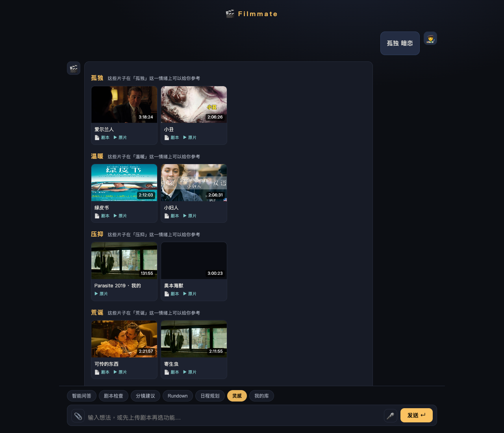

# 🎬 Filmmate · 影视创作 AI 助理

> **更新日志**：[`CHANGELOG.md`](CHANGELOG.md)　｜　**📁 仓库导航**：本目录是 2026-11-05 的 Python 原型（FastAPI + 原生 HTML/JS）。
> 团队正式栈（Tauri 2 + React + Vite + TS，Phase 1 聊天 UI + Phase 2 语音输入 + Phase 3 会话落盘 +
> Phase 4 工具调用可视化）在 **[`filmmate-web/`](filmmate-web/README.md)**，前后端消息契约在
> **[`filmmate-web/docs/CONTRACT.md`](filmmate-web/docs/CONTRACT.md)**。
> Phase 2 / Phase 3 的 Python 后端模块（`voice_input_api.py`、`chat_storage*.py`）在本目录根部，
> 由 `app.py` 一并注册。

**COMP4431 Artificial Intelligence (2026/27) Group Project — Domain-specific Chatbot**

一个面向影视/视频创作者的领域专属 AI 助理。定位是**辅助创作者做决策**,而不是替代创作:
帮创作者 **检查剧本漏洞 → 设计分镜 → 排拍摄 Rundown → 规划拍摄日程 → 找灵感/参考短片**,并回答
镜头语言、灯光、收音、剪辑等专业问题(中英双语)。

---

## 👥 组员信息(提交前填写)

| 姓名(Name) | 学号(Student ID) | 负责部分 |
|---|---|---|
| (你的名字) | (你的学号) | 后端 / LLM 集成 |
| (组员 2) | (学号) | RAG 知识库与案例库 |
| (组员 3) | (学号) | 前端 UI 与语音 |
| (组员 4,可选) | (学号) | 演示与测试 |

---

## ✨ 功能清单

### 基本功能(3/10)
1. **领域内沟通**:只围绕影视创作领域回答,领域外问题礼貌拒答并引导回创作话题;
2. **典型查询处理**:中英双语回答镜头语言(景别/机位/运镜)、灯光、收音、剪辑、拍摄流程、设备、香港取景地等专业问题;
3. **领域核心任务**:剧本检查、分镜建议、Rundown、日程规划等辅助任务。

### 附加功能(7/10)及实现方式

#### 1. RAG 知识库检索增强(双库检索)
- **专业知识库**(`knowledge/knowledge.json`,78 条):景别、机位、运镜、灯光、收音、剪辑、拍摄流程、香港取景、设备;
- **真实短片库**(`data/library/films_real.json`,78 部):全部来自 Bilibili 公开 API 校验,含标题/时长/UP主/简介/封面/原片链接;不写臆造的制作数据;
- 检索实现(`rag.py` / `case_store.py`):中文用 jieba 分词 + **Okapi BM25** 关键词检索;
  安装 `sentence-transformers` 后自动升级为 **dense 向量 + 余弦相似度**检索(向量缓存到 `*/vectors/` 下);
- 回答**附带来源引用**(知识条目 / 真实短片与剧本链接),不编造。

#### 2. 模型自主工具调用(Agent / Function Calling)
- 后端向 DeepSeek 声明两个检索工具 `search_knowledge` / `search_cases`(`llm.py` 的 `TOOLS_SCHEMA`);
- **模型自己决定**何时调用哪个工具、用什么关键词,后端执行真实检索,结果回填后模型再生成最终回答;
- 前端实时展示调用过程(🔧 search_cases(…)),演示时可直观看到 Agent 工作流;
- 无 API 时由规则路由器等价降级(离线模式)。

#### 3. 基于案例的生成(案例库 → 提示词)
- 用户用"分镜/Rundown/日程/灵感/审稿"时,先检索相关案例,把案例作为**高质量样本注入提示词**,
  模型借鉴其结构与经验、适配用户需求后输出(`tools.py` 中 case_ctx 注入);
- 离线模式下同样把案例附在结果中,并据案例填充设备/地点。

#### 4. 语音识别与合成
- 语音输入:浏览器 **Web Speech API(SpeechRecognition)**,支持普通话/粤语/英语,点 🎤 说话输入;
- 语音输出:**SpeechSynthesis** 朗读 AI 回答(每条回答带 🔊 按钮);
- 完全免费、无需训练、无需第三方服务。

#### 5. 结构化工具输出 + 友好界面
- 剧本检查:评分 + 漏洞卡片(严重程度/类型/原文引用/修改建议)+ 优点 + 下一步建议;
- 分镜建议:每个镜头一张 **SVG 简笔画草图**(按景别/机位自动生成构图)+ 景别/机位/运镜/时长标注;
- Rundown / 日程:**表格化呈现 + 一键导出 CSV**(带 BOM,Excel 直接打开);
- 灵感:概念卡片(梗概/钩子/反转);
- 电影风格深色 UI、流式输出(SSE)、聊天历史上下文(最近 6 轮)。

#### 6. 工程可靠性
- **离线演示模式**:未配置 API Key 时全部功能仍可用(本地检索 + 启发式剧本检查 + 模板生成),现场断网不翻车;
- JSON 输出自动校验/修复/重试;在线失败自动回退离线。

---

## 🧭 现状与下一步（Roadmap）

> 这一节只写「现在到哪、还差什么」，不把计划当成已完成功能。

| 方向 | 现在 | 下一步 |
|---|---|---|
| **1. 电影数据库** | 16 部「scriptslug 剧本 + B 站原片」长片；78 部短片仅作样本；个人库可加 B 站链接 + 剧本 | 统一到**长片主库 + 用户自建库**；补 synopsis/导演/类型/年代，支持全方位筛选与剧本全文搜索 |
| **2. 剧本理解** | PDF/DOCX 提取文本；在线 LLM coverage，离线启发式规则 | 场次/角色/对白/道具结构化，人物关系图、时间线校验，长剧本分块与跨块一致性 |
| **3. Rundown 导出** | 页面 stripboard + CSV | 一键导出 **.xlsx**（合并单元格/配色/列宽/合计，可直接打印的通告单） |
| **4. 日程规划** | 页面 + JSON/CSV | 生成 **.ics**，每个拍摄日/场次一个事件，双击导入 Apple/Google Calendar |
| **5. 2D Avatar** | 只有文字 + TTS 朗读 | 2D 角色（表情/口型/状态）与语音联动，优先低成本 Live2D/CSS 方案 |

### 1. 电影数据库：统一到长片 + 自建库

- **现在**：16 部双源长片（每部都有 scriptslug 剧本 PDF 与 B 站原片）、78 部短片样本；
  「我的库」可以粘贴 B 站链接、填情绪标签、附剧本。
- **不够**：搜索仍以关键词 + 情绪为主，没有剧情简介、导演、类型、年代等结构化字段，
  做不到「全方位搜索」；短片与长片两套库尚未真正合并。
- **下一步**：以长片为主库，补 synopsis/导演/类型/年代与剧本全文索引；
  支持按情绪/题材/年代/是否有剧本筛选；用户上传的剧本/影片作为「自建库」一等公民。

### 2. 剧本理解：从「读文本」到「读结构」

- **现在**：PDF/DOCX 提取纯文本；在线交给 LLM 做 coverage，离线用时间线/人物去向/对白长度等启发式规则。
- **不够**：没有稳定的场次切分、人物表、关系图与时间线；长剧本会截断，模型容易漏掉人物动机与潜台词。
- **下一步**：结构化解析（场景/角色/对白/动作/道具）、人物关系图、beat 与时间线校验；
  长剧本分块处理并做跨块一致性检查。

### 3. Rundown 一键导出 Excel

- **现在**：页面能看 stripboard（场次/INT-EXT/页数 1/8/company move/meal/cast calls/合计），导出 CSV。
- **下一步**：直接生成 `.xlsx`，保留合并单元格、配色、列宽与合计行，一键下载，
  打印出来就是现场能用的通告单。

### 4. 日程规划导出 .ics

- **现在**：日程只存在页面、JSON 和 CSV 里。
- **下一步**：生成 iCalendar（`.ics`），每个拍摄日/场次一个 `VEVENT`，带地点、时间、备注；
  双击导入 Apple Calendar / Google Calendar。

### 5. 2D Avatar

- **现在**：文字回答 + 浏览器 TTS 朗读，没有形象。
- **下一步**：2D 角色（表情、口型、状态）与语音输入/输出联动；优先做低成本的
  Live2D / CSS 方案，保证演示现场能跑。

---

## 🏗️ 架构

```
浏览器 (static/ HTML+CSS+JS)
  ├─ 语音输入 SpeechRecognition · 语音合成 SpeechSynthesis
  └─ POST /api/chat (SSE 流式)
        │
        ▼
FastAPI 后端 (app.py)
  ├─ 意图路由 (tools.detect_tool): 问答 / 剧本检查 / 分镜 / rundown / 日程 / 灵感 / 案例
  ├─ Agent 循环 (llm.chat_with_tools): 模型自主调用检索工具
  │     ├─ search_knowledge ──► rag.py  ──► knowledge.json (BM25 / dense 向量)
  │     └─ search_cases     ──► case_store.py ──► cases.json   (BM25 / dense 向量)
  ├─ 创作工具 (tools.py): 检索案例 → 注入提示词 → DeepSeek 结构化 JSON → 前端渲染
  └─ 离线降级: 本地检索 + 启发式规则(时间线/人物去向/伏笔/对白检查) + 模板生成
        │
        ▼
DeepSeek API (deepseek-chat, OpenAI 兼容接口;httpx 异步)
```

---

## Installation and setup

Use Python 3.12 and Node.js 22.12 or later with npm. Run these commands from the repository root unless a step says otherwise.

### 1. Install the Python dependencies

**macOS**

```bash
python3 -m venv .venv
.venv/bin/python -m pip install -r requirements.txt
```

**Windows**

```bat
python -m venv .venv
.venv\Scripts\python.exe -m pip install -r requirements.txt
```

### 2. Build the React frontend

Run the same commands on either platform.

```bash
cd filmmate-web
npm ci
npm run build
cd ..
```

The build writes to `filmmate-web/dist/`. Run `npm run build` inside `filmmate-web` again after changing the frontend.

### 3. Configure online chat and voice input (optional)

Copy `.env.example` to `.env` in the repository root. If you already have a `.env`, edit that file. Set `AI_GATEWAY_API_KEY` to use **Gemini 4 Hydrogen** for chat and **Whisper** for voice transcription through Vercel AI Gateway.

```ini
AI_GATEWAY_API_KEY=your_gateway_key
# GATEWAY_CHAT_MODEL=google/gemini-4-hydrogen
```

Chat can run offline using local retrieval and templates. The React microphone requires a gateway key or an `OPENAI_API_KEY` for transcription. If you set `DEEPSEEK_API_KEY`, direct DeepSeek takes priority for chat. Restart Filmmate after editing `.env`.

### 4. Launch Filmmate

| Platform | Double-click | Run manually from the repository root |
|---|---|---|
| macOS | `start.command` | `.venv/bin/python app.py` |
| Windows | `start.bat` | `.venv\Scripts\python.exe app.py` |

Open [Filmmate](http://127.0.0.1:8000). FastAPI serves the React UI and API on the same port. The launchers open the browser automatically. Press **Ctrl+C** to stop the server. On macOS, the launcher writes startup output to `start.log`.

The original HTML/JavaScript interface is available at [`/legacy`](http://127.0.0.1:8000/legacy).

### Optional development setup

For React development, run `npm run dev` inside `filmmate-web` and open [Vite](http://localhost:5173). To use live chat in Vite, start the Python server and set `VITE_API_BASE=http://127.0.0.1:8000` in `filmmate-web/.env`. With no API base configured, the standalone Vite app uses mock chat.

### Multilingual video sample search

Install `sentence-transformers` in the Python virtual environment to enable semantic sample search.

```bash
python -m pip install "sentence-transformers>=3,<6"
```

Activate `.venv` first or use its Python executable from step 4. On first startup, FastAPI downloads [Multilingual E5 Small](https://huggingface.co/intfloat/multilingual-e5-small) (about 470 MB) and caches the segment vectors in `data/sample-index/` before accepting requests. Later startups reuse the model and index. The default `EMBEDDING_MODE=auto` falls back to BM25 if initialization fails. Set `EMBEDDING_MODE=bm25` in the root `.env` to skip model loading.

Live chat can call `search_samples`, and storyboard and inspiration requests look up sample segments automatically. Each search returns up to three matches, with one segment per video. The model embeds each segment's original description, segment keywords, and video tags. Each result includes the timestamp, a link to that moment, and neighboring shot descriptions. Try asking `请找有小鴨在人行道上行走的片段，然後用它的鏡頭順序為寵物短片設計分鏡。`

### 7 分钟演示脚本建议
1. **剧本医生**(约 1.5 min):发送一段埋了 3 个漏洞的剧本(时间跳变、角色消失、伏笔未回收)
   → AI 逐一找出,按严重程度分类 + 原文引用 + 修改建议(强调"辅助人决策"的定位);
2. **分镜建议**(约 1.5 min):上传剧本 → 点"分镜建议" → 展示 shot list 与 SVG 分镜卡片;
3. **语音问答**(约 1 min):点 🎤 说"拍夜景需要准备什么灯光?" → RAG 回答 + 知识库引用 + 🔊 朗读;
4. **灵感/参考**(约 1 min):输入"孤独 暗恋" → 按情绪分组的真实电影静帧 + 剧本/原片链接;
5. **Rundown/日程**(约 1 min):生成通告单 + 导出 CSV;
6. 讲实现(RAG 双库、Agent 工具调用、提示词注入案例)+ 挑战与限制(约 1.5 min)。

---

## 🎙️ Phase 2 · 语音输入(voice input)

点麦克风 → 说话 → 再点一次停止 → whisper-1 转写 → **文字回填输入框,永不自动发送**。

### 文件分工

| 文件 | 角色 |
|---|---|
| `voice_input_api.py` | 后端 `POST /api/transcribe`:校验音频 → 转发上游 → 返回 `{"text": "..."}`;密钥只在服务端 |
| `filmmate-web/src/hooks/useVoiceInput.ts` | 录音状态机 `idle → requesting → recording → transcribing`;持有 MediaRecorder,任何退出路径都释放麦克风 |
| `filmmate-web/src/lib/voiceInput.ts` | 选择录音 MIME(webm/opus 优先)、检测环境支持、格式化计时 |
| `filmmate-web/src/lib/voiceInputApi.ts` | 浏览器端上传音频,把 401/413/429/504 等错误翻译成用户可读文案 |
| `filmmate-web/src/lib/voiceInputMerge.ts` | 把转写文本并入已有草稿(只补一个空格,不覆盖已输入内容) |
| `filmmate-web/src/components/MicButton.tsx` | 麦克风按钮:idle / 录音中(显示计时)/ 转写中 |
| `filmmate-web/src/components/Composer.tsx` | 接线:`onTranscript` → `mergeTranscript` → 写入输入框 |

### 工作流程

1. 点麦克风 → `getUserMedia` 申请权限 → `MediaRecorder` 以 32 kbps 开始录音(`webm/opus`);
2. 再点一次 / 按 `Enter` → 停止录音,得到音频 `Blob`;
3. `transcribeAudio()` → `POST {VITE_TRANSCRIBE_BASE}/api/transcribe`(multipart,`file=<audio>`);
4. 后端检查空音频与 25 MB 上限 → 转发上游 → 返回 `{ "text": "..." }`;
5. 前端 `mergeTranscript()` 把文字补到光标处,**不发送**,由用户自己按 Enter;
6. 录音中按 `Esc` 取消;短于 400 ms 视为误触;最长 120 s 自动停止。

### 使用的模型

| 项 | 值 |
|---|---|
| 模型 | `openai/whisper-1`(Gateway 默认)/ `whisper-1`(直连 OpenAI) |
| 默认上游 | Vercel AI Gateway `POST /v4/ai/transcription-model`(JSON + base64) |
| 备选上游 | OpenAI `POST /v1/audio/transcriptions`(标准 multipart) |
| 语言 | `TRANSCRIBE_LANGUAGE`(如 `zh` / `en` / `yue`),不填自动识别 |
| 术语提示 | `TRANSCRIBE_PROMPT`(仅直连 OpenAI 生效) |
| 限制 | 25 MB / 60 s 超时 |

> ⚠️ AI Gateway 的 `/v1/audio/transcriptions` 不存在(会 404),转写必须走 v4 端点;
> `MediaRecorder` 给的 `audio/webm;codecs=opus` 会先去掉 `;codecs=…` 再转发。

---

## 💾 Phase 3 · 会话落盘(chat storage)

聊天记录 → `UIMessage[]` → dict → **每个会话一个 JSON 文件**,刷新 / 重启后仍在。

### 文件分工

| 文件 | 角色 |
|---|---|
| `chat_storage.py` | 存储核心:原子写入(`.tmp` + `os.replace`)、按会话 id 加锁、id 正则校验、损坏文件隔离、标题推导 |
| `chat_storage_api.py` | 5 个 REST 路由 + Pydantic 校验,把存储异常翻译成 400 / 404 / 500 |
| `chat_storage_langchain.py` | 预留:LangChain `BaseMessage.to_dict()` ↔ dict(未接线,未加入 requirements) |
| `filmmate-web/src/lib/conversations.ts` | `ConversationRepository` 接口:`LocalRepository`(localStorage)/ `RemoteRepository`(REST),按环境变量选择 |
| `app.py` | 注册 `/api/transcribe` 与 `/api/conversations` 两个 router |

### 工作流程

1. **新建会话** → `PUT /api/conversations/<id>`,body `{"messages": []}` → 生成 `<id>.json`,标题暂为「新对话」;
2. **自动保存** → 发送消息后 500 ms debounce,以及回复结束(`ready` / `error`)时强制保存 → `PUT` 全量 `messages` → 原子重写文件;标题自动取第一条 user 消息(截 24 字);
3. **侧栏列表** → `GET /api/conversations` → 读取目录下所有 JSON 的 `id / title / createdAt / updatedAt`,按 `updatedAt` 倒序;
4. **打开会话** → `GET /api/conversations/<id>` → 返回 `{ messages }`;
5. **重命名** → `PATCH /api/conversations/<id>`;**删除** → `DELETE /api/conversations/<id>`。

### 落盘格式

`data/conversations/<id>.json`:

```json
{
  "version": 1,
  "id": "conv-m3k2j1-a1b2c3",
  "title": "第四場夜戲,先拍全景再切近景。",
  "createdAt": 1762900000000,
  "updatedAt": 1762900131000,
  "messages": [
    { "id": "m1", "role": "user",
      "parts": [{ "type": "text", "text": "第四場夜戲,先拍全景再切近景。" }] },
    { "id": "m2", "role": "assistant",
      "parts": [{ "type": "text", "text": "收到,先 wide shot 再 close-up。" }] }
  ]
}
```

- `messages` 就是前端 `UIMessage[]` 原样落盘(text / tool-call / reasoning 等 part 都保留);
- `createdAt` / `updatedAt` 是**毫秒时间戳**(number),与前端 `ConversationMeta` 一致;
- `version` 用于 schema 演进:未知版本只跳过,不擅自改写。

### 存储位置

| 项 | 值 |
|---|---|
| 默认目录 | 仓库根目录 `data/conversations/`(可用 `CONVERSATIONS_DIR` 覆盖) |
| 文件命名 | `<conversation-id>.json`,一个会话一个文件 |
| 是否进仓库 | 目录保留(`data/conversations/.gitkeep`),会话 JSON 不提交(`.gitignore`) |
| 开启方式 | `filmmate-web/.env`:`VITE_API_BASE=http://127.0.0.1:8000` + `VITE_REMOTE_CONVERSATIONS=1` |
| 关闭方式 | `VITE_REMOTE_CONVERSATIONS=0`(退回浏览器 localStorage,不产生文件) |

---

## 🎭 灵感 = 参考案例（已合并）

底部的「灵感」现在是唯一入口，不再有单独的「参考案例」：

- 输入一个主题（如「孤独 暗恋」），会先给出 3 个概念，再按**情绪分组**列出真实电影静帧：
  `孤独 → 爱尔兰人 / 小丑`、`温暖 → 绿皮书 / 小妇人`、`压抑 → 奥本海默 / 利益区域` …
- 静帧不是封面：用 B 站官方 `videoshot` 帧拼图裁出**整部片均匀分布的 6 帧真实画面**，点卡片可看 6 帧大图；
- 每张静帧都带 **▶ 原片（Bilibili）** 和 **📄 剧本（scriptslug PDF）**；
- 情绪分组优先匹配你输入的情绪词，其余按库内该情绪的影片数量排序；
- 点「我的库」可以粘贴 Bilibili 链接、填情绪标签，还可以**附一份剧本（PDF/DOCX）**；个人条目存本机 `data/personal/`（不进仓库），会自动混入情绪分组并标「我的」。

> 逐帧来源：B 站播放器预览帧（`/x/player/videoshot`，10×10 拼图，480×270/帧），
> 不下载整部影片；生成脚本 `python3 scripts/build_frames.py`，图片在 `static/frames/<bvid>/`。
> 这不是原片全分辨率截图，画质有限；如需 1080p 帧，需要下载原片后用 ffmpeg 抽取（版权/体积另议）。



## 📎 剧本上传（PDF / DOCX / TXT）

剧本检查、分镜建议、Rundown、日程规划都要求**先有剧本**：

1. 点输入框左侧 **📎**，选择 PDF / DOCX / TXT / Markdown / Fountain（≤ 15 MB）；
2. 服务端解析为纯文本（PDF 用 `pypdf`，DOCX 用 `python-docx`），页面显示「文件名 · 字数 · 已就绪」；
3. 选择功能并发送。没有剧本时点这四个功能，会提示先上传；
4. 灵感 / 参考案例不需要剧本，直接输入题材即可。

> 扫描版 PDF 若没有文字层，会提示需要先 OCR；文件只在内存中解析，不落盘。

## 🪟 极简界面

界面只保留三样东西：**顶部的 Filmmate logo、中间对话区、底部功能栏 + 输入框**。
原来的顶部导航、状态徽章、设置抽屉、示例剧本卡片全部移除；API Key 改由根目录 `.env` 配置。

## 🗂️ 数据层 v2（2026-11-13 大幅扩充）

原来的数据只有「50 个视频 + 78 条知识 + 10 个案例」，样本格式也只有 `time_start/time_end/description`，
撑不起专业的剧本审阅、分镜和通告单。现在扩充为五类可检索资料：

| 数据 | 数量 | 内容 |
|---|---|---|
| 专业知识库 | **198 条**（78 + 120 条扩充） | 剧本结构/审阅、人物、对白、类型片、场面调度、灯光、收音、剪辑、制片、通告单、场记、预算、勘景、香港拍摄、安全法规、后期交付 |
| 剧本 + 原片双源库 | **15 部**（36 部候选，严格匹配片长/单 P） | 每部同时有 **scriptslug 剧本 PDF** 与 **Bilibili 原片**，人工按情绪标注（孤独/压抑/浪漫/荒诞…） |
| 真实短片库 | **78 部** | Bilibili 公开 API 校验的短片/动画元数据（504 镜头解析）；目前作为独立样本保留，不混入「剧本+原片」情绪分组 |
| 场面模式库 | **40 个** | 每类戏的戏剧功能、节拍结构、冲突/潜台词、走位调度、建议镜头、光线声音、页数与拍摄分钟估算 |
| 镜头模式库 | **60 个** | 景别/机位/运镜/焦段/帧率/光线/声音/叙事用途/常见误用 |
| 通告单模板 | **7 套** | 单日广告、产品 demo、MV、3 天短片、纪录访谈、企业宣传片、8 天长片；`crew_call → setup → scene → move → meal → wrap` + 页数/时长合计 |
| 视频样本 | **50 个 / 504 镜头** | 在原时间码+描述基础上，自动解析出景别、机位、运镜、日夜、光线、节奏统计与场景分组（标注 `derived=true`，是推断而非原片分析） |

> **数据真实性**：早期原型里的 10 部案例和后来生成的 9 部「合成教学案例」**已全部删除**，不再进入检索。
> 「剧本 + 原片」库只收录 scriptslug 有剧本 PDF、且 Bilibili 有原片（时长与真实片长误差 ≤15 分钟、单 P）的电影；
> 匹配不到的 21 部直接列在 `misses` 里，不硬凑。
> 真实短片库的每条记录都带 `bvid`、`url`、`verified_at`，可用 `scripts/validate_data.py` 复核；
> 场面/镜头/通告单模板属于**编辑整理的方法库/行业模板**，不是影片档案，UI 与文档均已标注。

**完整字段规范见 [`docs/DATA_SCHEMA.md`](docs/DATA_SCHEMA.md)。**

### 这些数据怎么用

- 问答 Agent 有 **6 个检索工具**：`search_knowledge` / `search_cases` / `search_scenes` / `search_shots` / `search_stripboards` / `search_samples`；
- 五个创作工具在生成前会先检索对应资料（案例 + 场面 + 镜头 + 通告单模板）注入提示词；
- **Rundown 输出升级为 stripboard**：场次号、INT/EXT、场景标题、日/夜、演员、地点、页数（1/8 页）、预计拍摄分钟、company move、meal、cast calls、收工合计；
- **分镜输出升级为 shot list**：每场先给 coverage（master/OTS/singles/inserts），每个镜头带焦段、光线、声音、目的、转场；
- **日程输出升级为 DOOD**：每天页数/时长/转场/用餐合计、演员档期、风险与备案；
- 离线模式（没有 API Key）也能生成上述结构，数据全部来自本地资料库。

### 维护脚本

```bash
python3 scripts/validate_data.py     # 校验 schema / 枚举 / totals 求和一致性
python3 scripts/eval_retrieval.py    # 18 条代表性查询的检索命中率（当前 18/18）
python3 scripts/enrich_samples.py    # 重新从 _ref 样本生成富化数据
```

---

## 📁 文件结构

```
├── app.py               # FastAPI 入口,SSE 流式 /api/chat
├── config.py            # 配置(读 .env / 环境变量)
├── llm.py               # DeepSeek 客户端 + Agent 工具调用循环
├── prompts.py           # 系统提示词与各工具 JSON 规范
├── rag.py               # 专业知识库检索(BM25 / dense,合并扩充卷)
├── case_store.py        # 案例库检索(v2 字段)+ 案例上下文构建
├── library.py           # 场面/镜头/通告单/富化样本的统一加载与检索
├── tools.py             # 意图识别 + 五个创作工具(在线/离线双实现)
├── voice_input_api.py   # Phase 2:语音转写 /api/transcribe(whisper-1)
├── chat_storage.py      # Phase 3:会话 JSON 存储(原子写/加锁/损坏隔离)
├── chat_storage_api.py  # Phase 3:/api/conversations REST(5 个路由)
├── chat_storage_langchain.py # Phase 3:LangChain 消息 ↔ dict(预留,未接线)
├── requirements.txt
├── .env.example
├── start.command              # macOS 一键启动(FastAPI 提供 React 界面, 8000)
├── start.bat                  # Windows 一键启动(FastAPI 提供 React 界面, 8000)
├── start-filmmate.ps1         # start.bat 调用的 PowerShell 启动脚本
├── knowledge/knowledge.json   # 专业知识库(基础 78 条)
├── cases/                    # 已清空（虚构案例已移除，改用 data/library/films_real.json）
├── data/library/              # 数据层 v2（见 docs/DATA_SCHEMA.md）
│   ├── knowledge_extra.json   # 扩充知识 120 条
│   ├── scenes.json            # 场面模式 40 个
│   ├── shots.json             # 镜头模式 60 个
│   ├── stripboards.json       # 通告单模板 7 套
│   ├── films_real.json       # 真实短片库 78 部（Bilibili，含核验时间）
│   └── samples_enriched.json  # 50 个视频样本的专业富化
├── docs/DATA_SCHEMA.md        # 数据 schema 与质量规范
├── scripts/validate_data.py   # 数据校验
├── scripts/eval_retrieval.py  # 检索评测
├── scripts/enrich_samples.py  # 样本富化
├── scripts/build_scripted_films.py # 剧本+原片双源匹配（scriptslug × Bilibili）
├── scripts/build_frames.py    # 从 B 站 videoshot 抽真实静帧
├── static/frames/             # 每部电影 6 张真实静帧
├── data/conversations/        # Phase 3 会话存储目录(目录保留,会话 JSON 已 .gitignore)
├── filmmate-web/              # Tauri 2 + React 19 + Vite 前端(见其 README)
└── static/
    ├── index.html       # 聊天界面
    ├── style.css        # 电影风深色主题
    └── app.js           # SSE 渲染、语音、分镜 SVG、CSV 导出
```

---

## ⚠️ 已知限制

- **数据库**：当前是 16 部双源长片（剧本 + B 站原片）+ 78 部短片样本；
  没有 synopsis/导演/类型/年代等结构化字段，搜索以关键词和情绪为主；
- **剧本理解**：只做文本提取 + LLM/启发式检查，没有场次/角色/人物关系的结构化解析，
  长剧本会截断，深层动机与潜台词仍可能漏判；
- **导出**：Rundown 目前只导出 CSV，日程没有 `.ics`，都还没做成一键文件；
- **2D Avatar**：尚未实现，目前只有文字 + TTS 朗读；
- 离线模式的剧本检查基于启发式规则，无法做动机、潜台词层面的深度审阅；
- 语音输入依赖浏览器支持（推荐 Chrome），首次使用需授权麦克风；
- BM25 检索对同义词不敏感，安装 `sentence-transformers` 后可切换向量检索；
- 聊天上下文保留最近 6 轮；B 站链接可能随平台下架失效，需重新跑
  `scripts/build_scripted_films.py` 校验；
- 航拍等法规信息以官方发布为准。


## 🎞 影视灵感目录（Catalog：可看原片 + 每部 10 张静帧）

给「用户灵感 → 选题材 → LLM 生成创作思路 → 推荐相似作品」用的影片库：

- **规模**：261 部 / 9 类（电影、电视剧、长片、短片、竖屏短剧、广告/TVC、教程/产品演示、Vlog/美食、动画），每部 10 张代表性静帧，共 2610 张；
- **链接**：每条原片链接生成时实测可播放（Bilibili view + storyboard 双校验；YouTube 走 yt-dlp + 官方 storyboard），表格带「链接可信度 / 匹配视频 / UP主 / 核验时间」便于复核；
- **打开方式**：启动 Filmmate 后访问 http://127.0.0.1:8000/catalog（或 /static/catalog.html），支持按种类/情绪筛选、关键词搜索、点图放大、一键跳原片；
- **文件**：
  - data/library/catalog.json：机器可读总库（含 bvid、10 张静帧路径与时间码、标签、可信度）
  - docs/film_catalog.xlsx / .csv / FILM_CATALOG.md：编号-种类-中文名-英文名-年份-时长-情绪-内容梗概-Tag-原片链接（+ 静帧列）
  - docs/catalog.html + static/catalog.html：画廊
  - static/frames/catalog/：2610 张静帧
- **检索接口**：catalog.py 的 kind_options() / search() / suggest() / prompt_block()；tools.py 的灵感工具已接入，会基于真实作品生成创作思路；
- **重建/复核**：scripts/build_catalog.py（resolve / frames / export）、scripts/strict_clean.py（错链复核）、scripts/add_catalog_rows.py（合并外部片单）。


## 🎯 找灵感 v2：先选题材 → 只在对应库里找片 → 风格 / 主题 / 电影 → 确认出分镜

「找灵感」现在是入口第一个按钮，流程：

1. 点击 **找灵感** → 先选题材（电影 / 电视剧 / 长片 / 短片 / 竖屏短剧 / 广告/TVC / 教程 / Vlog / 动画）；
2. 用一句话描述你想要的感觉（例：香港、雨夜、旧楼、孤独、身份流动）；
3. 后端只在**你选的题材库**里检索真实作品（不会把短片/剧集的例子塞进电影灵感），再用模型生成：
   - 风格 1（为什么契合「香港」）
   - 主题 1（从零构思的可拍主题：人物 + 处境 + 冲突）
   - 契合电影 1（内容 + 3 张静帧 + 原片链接）
   - 风格 2 / 主题 2 / 电影 2（若有），最多到 3；
4. 最后反问「要不要按主题 1 出完整分镜？」→ 回复 **出分镜**（或「出分镜：主题名」）→ 输出对应主题的完整分镜表（8–10 个镜头：景别/机位/运镜/时长/画面/声音）。

实现位置：

- 前端：filmmate-web/src/components/Composer.tsx（题材选择 + 在消息前注入【题材：xxx】）
- 后端：tools.py 的 inspiration_films / storyboard_from_theme、catalog.py 的 semantic_candidates（含城市/地点线索）、prompts.py 的 PROMPT_INSPIRATION_FILMS / PROMPT_STORYBOARD_THEME
- 接口：POST /api/chat（React UIMessage 与旧版 SSE 两种格式都支持）；未选题材时会先返回「请先选题材」
- 自测：
  - 电影 + 香港 → 只会返回 电影 类目（甜蜜蜜 / 花样年华 / 重庆森林）
  - 短片 + 孤独 → 只会返回 短片 类目（小城二月 / 她和她的猫 / 地方守护神）
  - 回复「出分镜」→ 按上一轮「主题 1」生成 8–10 镜分镜


## 🧩 四个板块 v3：找灵感 / 剧本检查·生成 / 分镜建议·生成 / 拍摄计划

输入区顺序与功能：

1. **找灵感**（第一位）
   - 先选题材（电影/电视剧/长片/短片/竖屏短剧/广告/TVC/教程/Vlog/动画），只在该题材库里检索；
   - 输出：风格（为什么契合关键词）→ 主题 → 契合电影（内容 + 2x2 四格静帧，可点开放大 + 原片链接），最多 3 组；
   - 结尾先问「要不要按主题 1 先写剧本？」（不再是直接问分镜）。

2. **剧本检查/生成**
   - 有上传剧本：先识别是否剧本 → 检查冲突/漏洞 → 反问「要不要改成标准电影剧本格式」→ 改完可下载 PDF；
   - 没有剧本：按上一轮主题（或「写剧本：主题」）生成「梗要（片名+标题+主题+内容）+ 标准格式剧本」；
   - 输出面板：梗要卡片 + 可滚动剧本区 + 「下载 PDF」按钮。

3. **分镜建议/生成**
   - 必须先上传剧本（回形针上传 PDF/DOCX/TXT/MD/Fountain，或粘贴剧本）；
   - 自动生成梗要（片名+标题+主题+内容）+ 分镜表（镜号/场次/景别/机位/运镜/时长/画面/声音）；
   - 输出面板：梗要卡片 + 可滚动分镜表 + 「下载 CSV」按钮。

4. **拍摄计划**
   - 原 Rundown/日程能力，保留。

上传方式：输入区左侧回形针 → 上传后显示「已上传剧本：文件名（n 字）」，之后所有非找灵感的消息都会自动带上剧本原文，直到点「移除」。

接口：POST /api/chat（两种流式协议都支持）、POST /api/script/parse（上传解析）、POST /api/script/pdf（剧本转 PDF）。

## 🔧 v6 更新（2026-11-16 晚）：意图识别 / 板块模式 / 拍摄日历 / 参考片品味

**1. 分镜严格按剧本（修 bug）**
- 新增容错分场器 split_script_scenes：兼容「1. 内景 便利店 - 深夜」「第1场 内景 …」等格式；
- 分镜提示词改为逐场覆盖，并做「镜头描述 vs 剧本场次关键词」校验，不匹配自动改用规则分镜；
- 实测：便利店剧本 3 场 → 11 个镜头，逐场标题一致、剧本关键词命中 11/11。

**2. 找灵感 / 剧本按题材（TVC≠短片）**
- 每个题材都有独立的「灵感要求」与「剧本格式要求」：广告/TVC 输出 15/30/60 秒广告脚本表（镜头/画面/旁白/字幕/音效/slogan），不是电影剧本；
- 剧本生成会从历史里识别题材（或「写剧本：主题」+ 题材前缀），输出对应片种格式。

**3. 模糊意图识别**
- 现在输入「帮我做一个关于香港的短片」「寫一個關於香港的TVC劇本」「根据分镜生成拍摄计划」「检查一下我的剧本」都能猜中对应功能；
- 并从自然语言里抽出题材（短片/TVC/剧集…）与关键词（香港）。

**4. 板块模式（不再往输入框写「找灵感：」）**
- 点击「找灵感 / 剧本检查·生成 / 分镜建议·生成 / 拍摄计划」= 进入该功能模式，输入框不再插入任何字样；
- 当前功能显示在输入框上方提示条，可点「退出该功能」回到自动识别；
- 前端通过消息 metadata 把 tool/kind/最近剧本/最近分镜带给后端，跨板块衔接不丢上下文。

**5. 每个题材的提示语不同**
- 选「电影」提示：地点/人物/情绪；「广告/TVC」提示：产品/卖点/人群/想给的感受；「教程」提示：产品与功能；「Vlog/美食」提示：生活切片或美食；「竖屏短剧」提示：强钩子/爽点；「动画」提示：画风与世界观。

**6. 拍摄计划：一键按最近分镜生成 + 下载日历**
- 点「拍摄计划」直接用对话里最近一版分镜生成：概述 / 人员 / 器材 / 场景 / 拍摄日（call-wrap、场次、要点）/ 风险预案；
- 前端 SchedulePanel 支持「下载日历（.ics）」，可导入系统日历。

**7. 参考片库（用户自己的电影 + 链接）**
- 输入区「＋参考片」：填 Bilibili / YouTube 链接（片名可留空），后端自动抓标题/封面/时长，并用模型分析风格标签；
- 收藏后，找灵感与写剧本的提示词会自动带上「用户已收藏的参考片（代表他的品味）」，推荐更贴近用户口味；
- 接口：GET/POST/DELETE /api/library/personal。


## 🧰 v7 更新（2026-11-16 深夜）：面板位置 / 耗时 / 静帧过滤 / 回车分析 / 额度兜底

- **工具板块移到回答最后**：文字回答在前，灵感/剧本/分镜/拍摄计划卡片统一显示在正文之后。
- **真实耗时**：后端在 tool_data 里回传 ms，卡片不再永远显示 0ms（实测灵感 ~0.8–1.0s、分镜 ms>0）。
- **静帧过滤**：新增「黑底字幕卡」检测（画面>60% 纯黑 + 几乎无肤色 + 边缘为文字），抽帧时剔除；若一个上传大部分帧都是字幕卡则判定无效、重新匹配或从目录移除。已重配《三傻大闹宝莱坞》《绿皮书》，移除无合适画面的《初代iPhone使用导览》。当前目录：260 部 / 2600 张静帧（Bilibili 230 + YouTube 30，可信度 高 148 / 中 112）。
- **上传剧本后回车即分析**：输入框为空也可以直接 Enter，按当前板块执行默认动作（剧本检查 / 出分镜 / 拍摄方案）。
- **模型额度不足的兜底**：
  - 问答：自动回退本地知识库并提示原因；
  - 找灵感：回退规则版（仍按题材划库、带静帧与链接）；
  - 分镜：回退规则分镜（严格按剧本场次）；
  - 拍摄计划：回退规则版拍摄日；
  - 写剧本：明确提示「模型额度已用尽，请更换 AI_GATEWAY_API_KEY / DEEPSEEK_API_KEY」。
  - 之前出现的 "The chat request failed" 现在会变成可读的原因提示，不会白屏。


## v8 更新（2026-11-17）：切换 DeepSeek 官方 API

- .env 改为使用 DEEPSEEK_API_KEY 直连 https://api.deepseek.com，provider 自动切到 deepseek；
- DeepSeek 官方支持的模型名只有 deepseek-flash / deepseek-v4-pro（deepseek-v4.1-flash 不存在，会报 invalid_request_error）；当前使用 deepseek-flash；
- 回归实测（全部 online）：
  - 找灵感（电影+香港）：18.6s，重庆森林 / 甜蜜蜜 / 色，戒；
  - 找灵感（广告/TVC）：19.7s，梦骑士 / 真美画像 / 雇佣车手；
  - 写剧本（TVC）：19.8s，film_kind=广告/TVC，《最热的一单》1887 字广告脚本；
  - 分镜：24.5s，3 场 13 镜，剧本关键词命中 13/13；
  - 拍摄计划：30.2s，2 个拍摄日 + 2 条日历事件；
  - 工具耗时显示真实毫秒（不再 0ms）。
